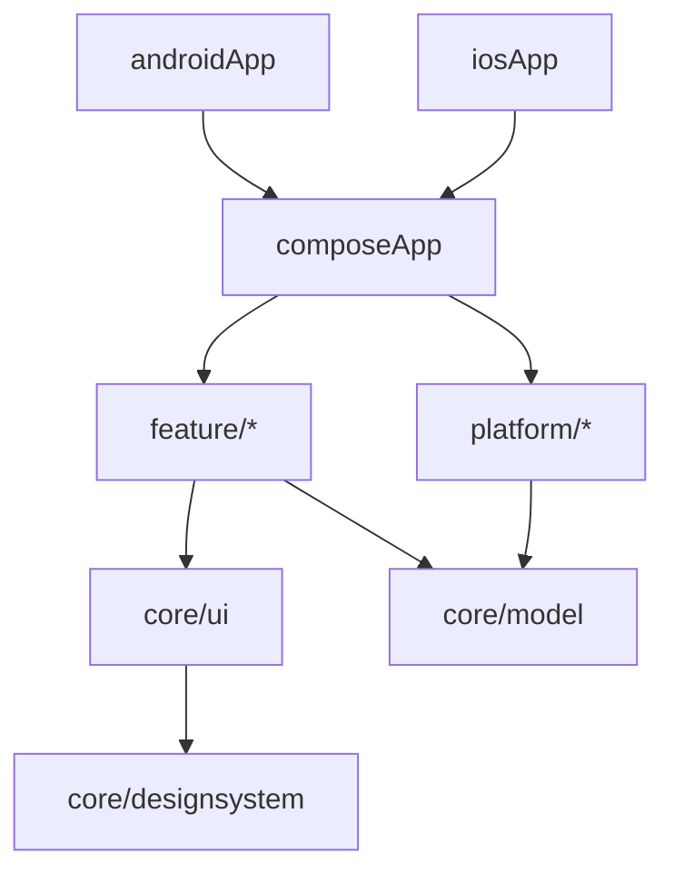

# 모듈 경계

> 상태: Accepted
> SSOT: Git Repository
> 원본: [Architecture v1](overview.md)
> 최종 검토일: 2026-11-17

ICEC는 프로젝트 규모에 맞는 목적 중심 모듈화를 사용합니다.

```text
androidApp
composeApp
iosApp

core/
  designsystem
  ui
  model

feature/
  home
  gallery
  editor
  result

platform/
  image
  face-detection
  media
```

## 책임

- `androidApp`: Android 진입점(`MainActivity`, 매니페스트, applicationId). `composeApp`의 `App()`만 호출합니다([ADR-0002](../adr/0002-android-app-module.md)).
- `composeApp`: 공통 UI 진입점(`App()`), iOS 프레임워크, 공통 back stack과 전체 의존성 조립.
- `iosApp`: iOS 진입점 Xcode 프로젝트. `composeApp` 프레임워크를 링크합니다.
- `core/designsystem`: Compose로 표현되는 디자인 토큰과 재사용 컴포넌트 계약.
- `core/ui`: 여러 feature에서 실제로 공유하는 UI 기반 요소.
- `core/model`: 플랫폼 독립 공통 모델.
- `feature/*`: 기능별 화면, `Action`, `UiState`, `Effect`, ViewModel과 UI 로직.
- `feature/editor`: 초기에는 `FaceAnalysis`(얼굴 검출·복구)와 `Editor`(얼굴 선택·모자이크·저장)의 **서로 다른 Navigation Route**를 함께 소유합니다. 별도 Gradle 모듈을 추가하지 않으며 Route별 상태와 책임을 혼동하지 않습니다([ADR-0001](../adr/0001-face-analysis-route.md)).
- `platform/*`: Android/iOS SDK, 이미지 타입, 권한과 저장 API 같은 네이티브 기능 경계.

## 의존성 규칙



- feature 사이에는 직접 의존성을 만들지 않습니다.
- feature는 플랫폼 구현체 대신 `platform/*`이 제공하는 공통 계약에 의존합니다.
- 공통 back stack과 feature 연결은 `composeApp`이 조립합니다. `androidApp`과 `iosApp`에는 기능 코드를 두지 않습니다.
- 패키지는 모듈의 목적을 반영하고, 초기에는 불필요한 `data/domain/presentation` 하위 계층을 만들지 않습니다.
- 파일 수와 변경 이유가 실제로 분리될 때만 모듈 또는 하위 패키지를 추가합니다.
- 2026-11-17 현재 Home은 `composeApp`의 `home` 패키지에 있습니다. Home은 상태와 플랫폼 의존성이 없습니다. `feature/*` 모듈은 Gallery 구현과 Metro 도입 때 분리합니다.
